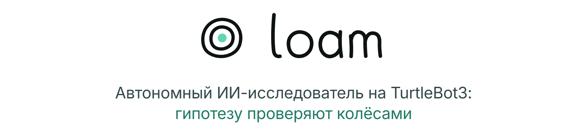
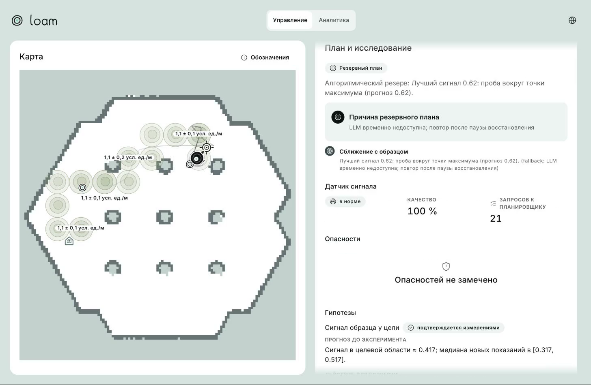
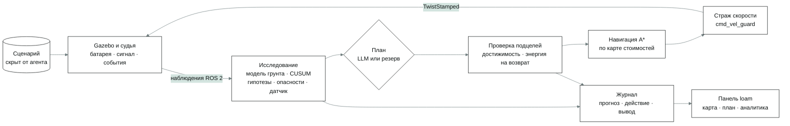
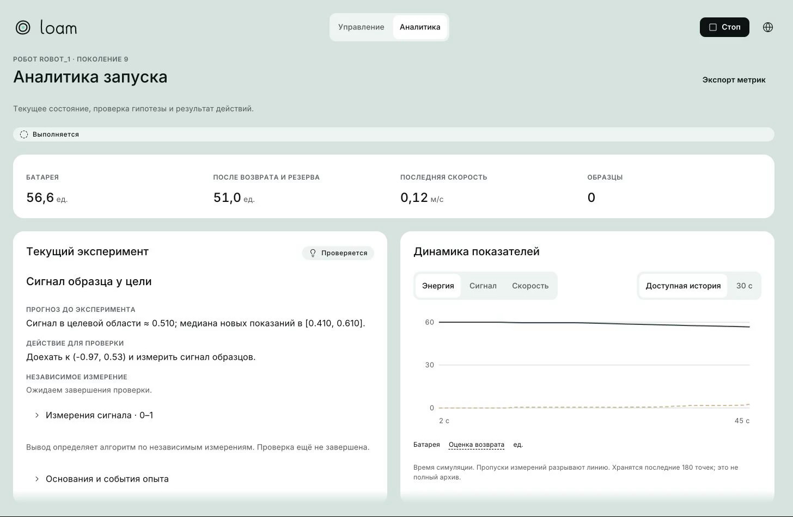
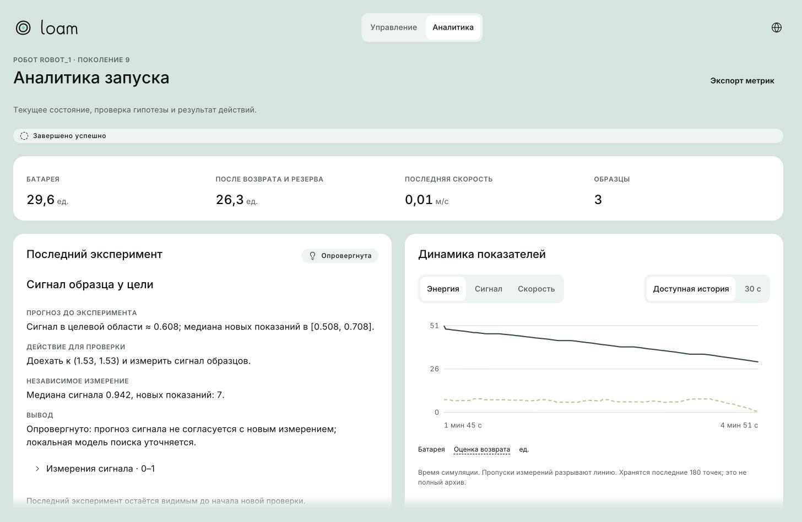

<p align="center">
  <picture>
    <source media="(prefers-color-scheme: dark)" srcset="docs/readme/banner.dark.png">
    
  </picture>
</p>

<p align="center">
  loam сам выдвигает гипотезы, проверяет их собственными колёсами, учится по расходу батареи, где грунт
  дорогой, собирает скрытые образцы и всегда возвращается на базу.
</p>

<p align="center">
  <!-- readme:buttons -->
  <a href="#запуск"><picture><source media="(prefers-color-scheme: dark)" srcset="docs/readme/cta-run.dark.png"></picture></a>
  <a href="artifacts/runs/2026-10-09-easy-seed7/README.md"><picture><source media="(prefers-color-scheme: dark)" srcset="docs/readme/cta-example.dark.png"></picture></a>
  <a href="docs/README.md"><picture><source media="(prefers-color-scheme: dark)" srcset="docs/readme/cta-docs.dark.png"></picture></a>
  <!-- /readme:buttons -->
</p>

<p align="center">
  <!-- readme:status -->
  <a href="#результаты"><picture><source media="(prefers-color-scheme: dark)" srcset="docs/readme/badge-status-1.dark.png"></picture></a>
  <a href="#результаты"><picture><source media="(prefers-color-scheme: dark)" srcset="docs/readme/badge-status-2.dark.png"></picture></a>
  <br>
  <a href="#запуск"><picture><source media="(prefers-color-scheme: dark)" srcset="docs/readme/badge-status-3.dark.png"></picture></a>
  <a href="LICENSE"><picture><source media="(prefers-color-scheme: dark)" srcset="docs/readme/badge-status-4.dark.png"></picture></a>
  <!-- /readme:status -->
</p>

<p align="center">
  <!-- readme:stack -->
  <picture><source media="(prefers-color-scheme: dark)" srcset="docs/readme/badge-stack-1.dark.png"></picture>
  <picture><source media="(prefers-color-scheme: dark)" srcset="docs/readme/badge-stack-2.dark.png"></picture>
  <picture><source media="(prefers-color-scheme: dark)" srcset="docs/readme/badge-stack-3.dark.png"></picture>
  <br>
  <picture><source media="(prefers-color-scheme: dark)" srcset="docs/readme/badge-stack-4.dark.png"></picture>
  <picture><source media="(prefers-color-scheme: dark)" srcset="docs/readme/badge-stack-5.dark.png"></picture>
  <!-- /readme:stack -->
</p>

<p align="center">
  <!-- readme:nav -->
  <a href="#зачем-это"><picture><source media="(prefers-color-scheme: dark)" srcset="docs/readme/badge-nav-1.dark.png"></picture></a>
  <a href="#как-это-работает"><picture><source media="(prefers-color-scheme: dark)" srcset="docs/readme/badge-nav-2.dark.png"></picture></a>
  <a href="#попробовать-за-две-минуты"><picture><source media="(prefers-color-scheme: dark)" srcset="docs/readme/badge-nav-3.dark.png"></picture></a>
  <br>
  <a href="#результаты"><picture><source media="(prefers-color-scheme: dark)" srcset="docs/readme/badge-nav-4.dark.png"></picture></a>
  <a href="#запуск"><picture><source media="(prefers-color-scheme: dark)" srcset="docs/readme/badge-nav-5.dark.png"></picture></a>
  <a href="#устройство"><picture><source media="(prefers-color-scheme: dark)" srcset="docs/readme/badge-nav-6.dark.png"></picture></a>
  <a href="#ограничения"><picture><source media="(prefers-color-scheme: dark)" srcset="docs/readme/badge-nav-7.dark.png"></picture></a>
  <!-- /readme:nav -->
</p>

<p align="center">
  
  <br>
  <sub>Настоящий прогон в Gazebo, easy seed 7: робот идёт к максимуму сигнала, на карте его оценки стоимости грунта.</sub>
</p>

## Зачем это

Нужен робот, который ведёт себя как исследователь, а не как пылесос с картой. На арене спрятаны
образцы, грунт местами дорогой, батарея ограничена, а в сложном сценарии среда меняется без
предупреждения: дорожает грунт, появляется опасная зона, сбоит датчик. Готового ответа нет:

- где лежат образцы, видно только по слабому сигналу датчика, который падает с расстоянием;
- сколько стоит проезд, видно только по тому, как быстро тает батарея на метр пути;
- если среда изменилась, старая модель продолжает уверенно врать, а робот об этом не знает.

loam решает это научным циклом: гипотеза → проверочное действие → независимое измерение → вывод →
новое решение. Каждый прогноз записывается до поездки, каждый вывод опирается на измерения после неё,
а журнал объясняет, почему робот поехал именно туда.

## Как это работает



- **LLM предлагает, код проверяет.** Языковая модель по тексту миссии и состоянию предлагает
  последовательность подцелей. Каждую подцель код проверяет на достижимость и запас энергии на
  возврат, скоростью управляет алгоритм. Если модель молчит, медлит или ошибается, включается
  резервный планировщик, и панель показывает причину.
- **Гипотезу проверяют колёсами.** Перед поездкой агент записывает численный прогноз: расход на метр,
  сигнал в точке, интервал допустимых значений. Вывод считает алгоритм по новым измерениям:
  подтверждена, опровергнута или данных мало. Опровержение меняет карту стоимостей и следующий маршрут.
- **Агент не видит ответов.** Истина сценария есть только у судьи. Агент получает одометрию, лидар,
  батарею, датчик образцов и события столкновений, а изменения среды обнаруживает сам, по расхождению
  прогноза с измерениями.

Модель грунта — регуляризованная оценка расхода по участкам карты. Детектор CUSUM замечает, что расход
на знакомом участке перестал совпадать с прогнозом, и открывает гипотезу о смене режима. Опасные зоны
восстанавливаются из событий `hazard_hit`, а монитор датчика запрещает собирать образец вслепую, пока
сигнал шумит, залип или пропал. Страж скорости обнуляет команды, если процесс агента пропал или
наблюдения устарели.

<p align="center">
  
  <br>
  <sub>Вкладка «Аналитика»: текущий эксперимент, его прогноз до поездки и динамика энергии с оценкой возврата.</sub>
</p>

## Попробовать за две минуты

| Шаг | Что сделать | Что увидите |
|---|---|---|
| 1 | Запустите стек по разделу [Запуск](#запуск) и откройте <http://localhost:8080> | Карту арены и карточку миссии со статусом среды |
| 2 | Выберите профиль easy, medium или hard, seed и нажмите «Старт» | Робот трогается, на карте появляется маршрут и цель, справа план с причиной |
| 3 | Откройте «План и исследование» | Предпосылки плана, состояние датчика, открытые гипотезы и модель грунта |
| 4 | Переключитесь на «Аналитику» | Прогноз, действие, измерение, вывод и график энергии |
| 5 | Откройте журнал и скачайте его | JSON всего прогона для разбора и воспроизведения |

Чтобы посмотреть интерфейс без симуляции, соберите панель в демо-режиме: 16 сценариев с записанными
данными покрывают каждое состояние контракта, от отказа LLM до потери партнёра.

## Результаты

[Записанный прогон](artifacts/runs/2026-10-09-easy-seed7/README.md): сценарий easy, seed 7, готовая
карта, один робот, миссия «Собрать как можно больше образцов и вернуться на базу».

| Показатель | Значение |
|---|---:|
| Итог | **completed**, возврат на базу |
| Собрано образцов | **3 из 3** |
| Батарея в конце | **29,61 из 60** |
| Время симуляции | 291,4 с |
| Гипотез | **34**: 13 подтверждены, 8 опровергнуты, 13 с недостаточными данными |
| Проверка научной цепочки | 0 дефектов: у каждого вывода есть прогноз, действие и измерение |

Одна из опровергнутых гипотез, как её записал агент:

| Прогноз до поездки | Действие | Независимое измерение | Вывод |
|---|---|---|---|
| Сигнал в целевой области ≈ 0,608, медиана новых показаний в [0,508; 0,708] | Доехать к (1,53; 1,53) и измерить сигнал | Медиана 0,942 по 7 новым показаниям | **Опровергнуто**: локальная модель поиска уточняется |

| Проверка | Результат | Команда |
|---|---|---|
| Backend | 327 тестов, 3 ROS-теста пропускаются вне контейнера | `cd backend && python -m pytest tests -q` |
| Судья, карты, стенд | 122 теста | `pytest simulation/judge/tests simulation/mapping/tests scripts/evaluation/tests -q` |
| Frontend | 1020 unit-тестов, typecheck, lint, сборка | `cd frontend && npm run verify` |
| Браузер | Playwright: 16 сценариев × ru/en × три ширины, axe; 223 из 223 | `cd frontend && npm run e2e` |

<p align="center">
  
  <br>
  <sub>Итог: три образца, возврат с запасом. Все планы в этом прогоне выдал резервный планировщик.</sub>
</p>

## Запуск

```bash
cp -n .env.example .env
docker compose up -d --build
docker compose --profile gui up -d gui
```

Панель откроется на <http://localhost:8080>, Gazebo — на <http://localhost:6080/vnc.html>. Если порт
занят, задайте `FRONTEND_PORT` или `GUI_PORT`. Без ключа работает всё, кроме внешней модели: планы
выдаёт резервный планировщик. Чтобы подключить LLM, заполните в `.env` переменные `LLM_ENDPOINT`,
`LLM_MODEL` и `LLM_API_KEY`. Первая сборка образа симуляции скачивает ROS 2 Jazzy, Gazebo Harmonic и
пакеты TurtleBot3.

Прогон без браузера: `python3 scripts/run_mission.py SEED`, итог и журнал сохраняются в `artifacts/`.

## Устройство

```text
backend/      агент: исследование, планировщик, навигация, HTTP API
simulation/   Gazebo, судья, сценарии, SLAM, два робота
frontend/     панель loam
contracts/    примеры ответов API
scripts/      прогон миссии, анализ, стенд оценки
artifacts/    записанные прогоны и разборы
```

| Документ | Что внутри |
|---|---|
| [Симуляция](simulation/README.md) | Gazebo, супервизор сброса, профили сценариев, SLAM, два робота |
| [Судья](simulation/judge/README.md) | Батарея, сигнал образцов, collect и finish, счёт, скрытые события hard |
| [Панель](frontend/README.md) | Архитектура интерфейса, демо-режим, проверки и e2e |
| [Примеры API](contracts/examples/README.md) | Ответы `/api/v1`: состояние, карта, журнал, команда, ошибки |

## Ограничения

- **Судья локальный.** Расход, штрафы и формула счёта — допущения проекта по тексту ТЗ, полные правила
  официального судьи не опубликованы. Интерфейс `/did/*` совпадает с заданием.
- **Грунт замедляет программно.** Дорогой участок увеличивает расход и ограничивает скорость через
  страж команд, а не через трение в физике Gazebo.
- **Внешняя модель медленная.** В записанном прогоне все планы выдал резервный планировщик: модель не
  укладывалась в бюджет 8 с. Путь с LLM проверен отдельными запросами, серии живых прогонов с ней нет.
- **Полностью подтверждён один сценарий.** easy пройден в Gazebo от начала до конца. medium и hard
  работают, но серия прогонов с метриками адаптации есть только на подменной среде. SLAM и два робота
  реализованы и проверены отдельно, в общую точку сборки ещё не включены.
- **Холодный старт Gazebo бывает долгим.** На медленной машине первый запуск может не уложиться в
  120 с, и супервизор пометит его неуспешным; повторный сброс поднимает среду.

## Лицензия

[MIT](LICENSE)
