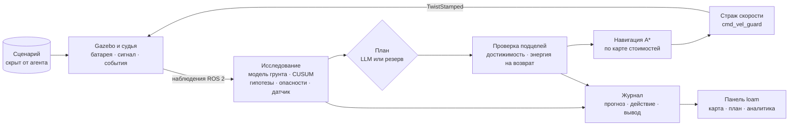
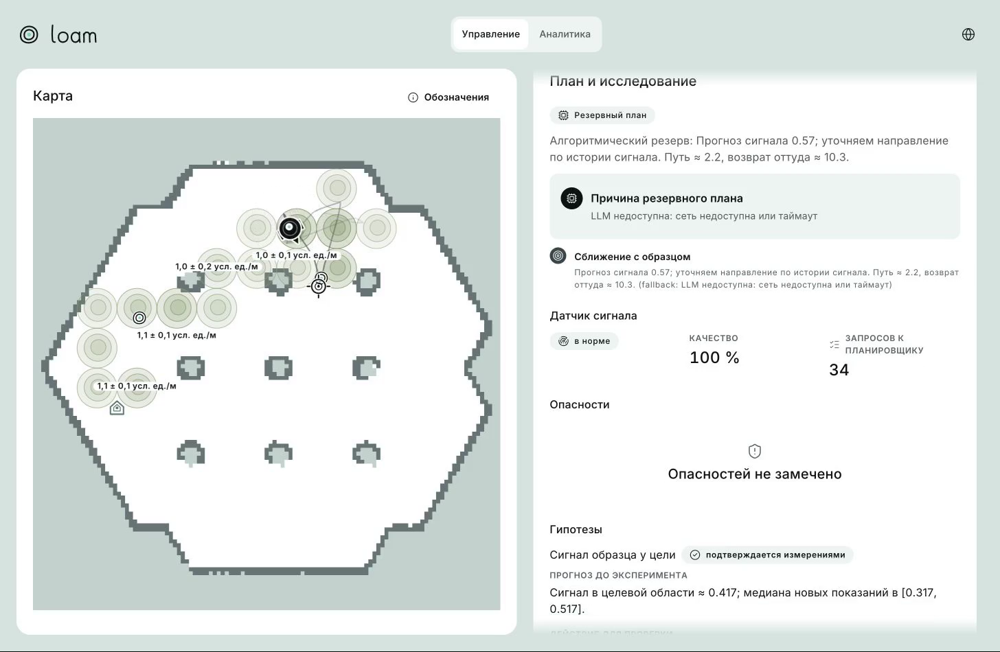
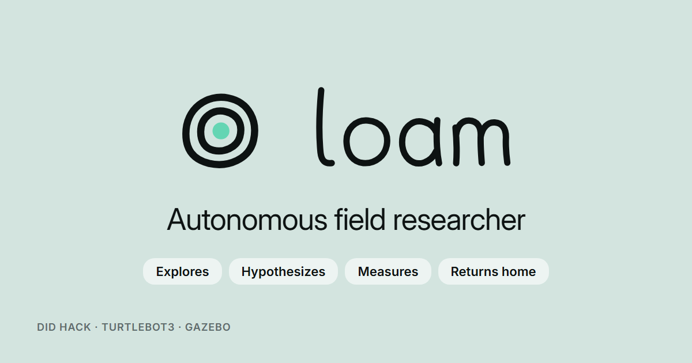

<p align="center">
  <picture>
    <source media="(prefers-color-scheme: dark)" srcset="docs/brand/wordmark-dark.svg"/>
    
  </picture>
</p>

<p align="center">
  <b>Автономный ИИ-исследователь на TurtleBot3.</b><br/>
  loam сам выдвигает гипотезы, проверяет их собственными колёсами, учится по расходу батареи,<br/>
  где грунт дорогой, собирает скрытые образцы и всегда возвращается на базу.
</p>

<p align="center">
  <a href="#идея"></a>
  <a href="#три-решения"></a>
  <a href="#как-это-работает"></a>
  <a href="#пример"></a>
  <a href="#как-пользоваться"></a>
  <a href="#что-проверено"></a>
  <a href="#запуск"></a>
  <a href="#ограничения"></a>
</p>

<p align="center">
  
  
  
  
  
  
  
</p>

<p align="center">
  
</p>

<p align="center"><sub>Кадр записи настоящего прогона в Gazebo, easy seed 7. Робот идёт к максимуму сигнала, на карте видны его оценки стоимости грунта, справа — план и гипотеза, которую сейчас подтверждают измерения.</sub></p>

---

## Идея

Задача хакатона — робот, который ведёт себя как исследователь, а не как пылесос с картой. На арене спрятаны
образцы, грунт местами дорогой, батарея ограничена, а в сложном сценарии среда меняется без
предупреждения: дорожает грунт, появляется опасная зона, сбоит датчик. Готового ответа нет:

- где лежат образцы, видно только по слабому сигналу датчика, который падает с расстоянием;
- сколько стоит проезд, видно только по тому, как быстро тает батарея на метр пути;
- если среда изменилась, старая модель продолжает уверенно врать, а робот об этом не знает.

loam решает это научным циклом: **гипотеза → проверочное действие → независимое измерение → вывод →
новое решение**. Каждый прогноз записывается до поездки, каждый вывод опирается на измерения после неё,
а журнал объясняет, почему робот поехал именно туда.

## Три решения

<table>
<tr>
<td valign="top" width="33%">

**LLM предлагает, код проверяет**

Языковая модель работает только на верхнем уровне: по тексту миссии и состоянию она предлагает
последовательность подцелей. Каждую подцель код проверяет на достижимость и запас энергии на возврат;
скоростью управляет алгоритм. Если модель молчит, медлит или ошибается, включается явный резервный
планировщик, и панель показывает причину.

</td>
<td valign="top" width="33%">

**Гипотезу проверяют колёсами**

Прежде чем ехать, агент записывает численный прогноз: расход на метр, сигнал в точке, интервал
допустимых значений. После поездки вывод считает алгоритм по новым измерениям, а не модель:
подтверждена, опровергнута или данных мало. Опровержение меняет карту стоимостей и следующий маршрут.

</td>
<td valign="top" width="33%">

**Агент не видит ответов**

Истина сценария — где образцы, где границы грунтов, когда сработают события — есть только у судьи.
Агент получает те же сигналы, что получил бы настоящий робот: одометрию, лидар, батарею, датчик
образцов и события столкновений. Изменения среды он обнаруживает сам, по расхождению прогноза с
измерениями.

</td>
</tr>
</table>

## Как это работает



Модель грунта — регуляризованная оценка расхода по участкам карты; детектор CUSUM замечает, что расход
на знакомом участке перестал совпадать с прогнозом, и открывает гипотезу о смене режима. Опасные зоны
восстанавливаются из событий `hazard_hit`, а монитор датчика запрещает собирать образец вслепую, пока
сигнал шумит, залип или пропал. Страж скорости обнуляет команды, если процесс агента пропал или
наблюдения устарели.

<p align="center">
  
</p>

<p align="center"><sub>Вкладка «Аналитика» во время того же прогона: текущий эксперимент, его прогноз до поездки и динамика энергии с оценкой возврата.</sub></p>

Подробно по частям:

- [Симуляция, судья и сценарии easy/medium/hard](simulation/README.md)
- [Правила локального судьи: расход, сигнал, штрафы, скрытые события](simulation/judge/README.md)
- [Панель: архитектура, дизайн-система, режимы показа](frontend/README.md)
- [HTTP API: примеры ответов](contracts/examples/README.md)

## Пример

Вход — сценарий easy, seed 7, готовая карта, один робот, миссия «Собрать как можно больше образцов и
вернуться на базу». Выход — запуск `31f8dad3`, записанный от первого до последнего кадра:

| Показатель | Значение |
|---|---:|
| Итог | **completed**, возврат на базу |
| Собрано образцов | **3 из 3** |
| Батарея в конце | **29,61 из 60** |
| Время симуляции | 291,4 с |
| Гипотез | **34**: 13 подтверждены, 8 опровергнуты, 13 с недостаточными данными |
| Проверка научной цепочки | 0 дефектов: у каждого вывода есть прогноз, действие и измерение |

Одна из опровергнутых гипотез, как её записал агент:

| Прогноз до поездки | Действие | Независимое измерение | Вывод |
|---|---|---|---|
| Сигнал в целевой области ≈ 0,608, медиана новых показаний в [0,508; 0,708] | Доехать к (1,53; 1,53) и измерить сигнал | Медиана 0,942 по 7 новым показаниям | **Опровергнуто**: локальная модель поиска уточняется |

<p align="center">
  
</p>

<p align="center"><sub>Итоговый экран: три образца, возврат с запасом, последний эксперимент опровергнут измерением. Все планы в этом прогоне выдал резервный планировщик, внешняя модель не отвечала в срок.</sub></p>

## Как пользоваться

| Шаг | Что сделать | Что увидите |
|---|---|---|
| 1 | Запустите стек ([как](#запуск)) и откройте `http://localhost:8080` | Логотип loam, карту арены и карточку миссии со статусом среды |
| 2 | Выберите тип задачи, профиль easy, medium или hard, seed и нажмите «Старт» | Робот трогается, на карте появляется маршрут и цель, справа план с причиной |
| 3 | Следите за картой | Траекторию, оценки стоимости грунта с неопределённостью, найденные опасности, собранные образцы |
| 4 | Откройте «План и исследование» | Предпосылки плана, состояние датчика, открытые гипотезы и модель грунта |
| 5 | Переключитесь на «Аналитику» | Текущий эксперимент: прогноз, действие, измерение, вывод, и график энергии |
| 6 | Откройте журнал | Временную шкалу: каждое решение, гипотеза, эксперимент и вывод с временем симуляции |
| 7 | Скачайте журнал иконкой экспорта | JSON всего прогона для разбора и воспроизведения |

<table>
<tr>
<td width="50%"></td>
<td width="50%"></td>
</tr>
<tr>
<td align="center"><sub>Вторая половина прогона: оценки грунта вдоль пройденного пути</sub></td>
<td align="center"><sub>Знак loam: две изолинии вокруг найденного образца</sub></td>
</tr>
</table>

Чтобы смотреть интерфейс без симуляции, соберите панель в демо-режиме: 16 сценариев с заранее
записанными данными покрывают каждое состояние контракта, от отказа LLM до потери партнёра.
Gazebo вживую открывается в браузере через noVNC.

## Что проверено

| Что | Результат | Где смотреть |
|---|---|---|
| Полный прогон в Gazebo | easy seed 7: 3 образца, возврат, 29,61/60 батареи, 34 гипотезы, видео 6:09 | [`artifacts/demo/2026-10-09`](artifacts/demo/2026-10-09/README.md) |
| Научная цепочка | 0 дефектов: прогноз до действия, независимое измерение, вывод по алгоритму | [`science-chain.txt`](artifacts/demo/2026-10-09/science-chain.txt) |
| Backend | 327 тестов: ядро, исследования, планировщик, HTTP-контракт, команда роботов; 3 ROS-теста пропускаются вне контейнера | `cd backend && python -m pytest tests -q` |
| Судья, карты, стенд | 122 теста: расход, сигнал, collect и finish, скрытые события, склейка карт двух роботов | `pytest simulation/judge/tests simulation/mapping/tests scripts/evaluation/tests -q` |
| Frontend | 1020 unit-тестов, typecheck, lint, сборка и проверки правил кода | `cd frontend && npm run verify` |
| Браузер | E2E на Playwright: 16 сценариев демо × ru/en × три ширины × обычное и сниженное движение, axe; последний полный прогон 223 из 223 | `cd frontend && npm run e2e` |

Полный прогон — один запуск, а не серия: он показывает, что цикл «гипотеза → действие → измерение →
вывод» работает на настоящей физике, но не доказывает устойчивость на medium и hard. Адаптация к скрытым
изменениям и координация двух роботов проверены на подменной среде с теми же портами, что у ROS.

## Запуск

```bash
cp -n .env.example .env
docker compose up -d --build
docker compose --profile gui up -d gui
```

Панель откроется на `http://localhost:8080`, Gazebo — на `http://localhost:6080/vnc.html`. Если порт
занят, задайте `FRONTEND_PORT` или `GUI_PORT`. Без ключа работает всё, кроме внешней модели: планы
выдаёт резервный планировщик, и панель это показывает. Чтобы подключить LLM, заполните в `.env` три
переменные: `LLM_ENDPOINT`, `LLM_MODEL`, `LLM_API_KEY`. Первая сборка образа симуляции занимает время:
скачиваются ROS 2 Jazzy, Gazebo Harmonic и пакеты TurtleBot3.

Прогон без браузера: `python3 scripts/run_mission.py SEED`, итог и журнал сохраняются в `artifacts/`.

## Документация

| Раздел | Что внутри |
|---|---|
| [Симуляция](simulation/README.md) | Gazebo, супервизор сброса, профили сценариев, SLAM, два робота |
| [Судья](simulation/judge/README.md) | Батарея, сигнал образцов, collect и finish, счёт, скрытые события hard |
| [Панель](frontend/README.md) | Архитектура интерфейса, демо-режим, проверки и e2e |
| [Примеры API](contracts/examples/README.md) | Ответы `/api/v1`: состояние, карта, журнал, команда, ошибки |
| [Запись показа](scripts/defense/README.md) | Как записываются прогон, кадры и видео для защиты |

## Ограничения

- **Судья локальный.** Расход, штрафы и формула счёта — допущения проекта по тексту ТЗ, полные правила
  официального судьи не опубликованы. Интерфейс `/did/*` совпадает с заданием.
- **Грунт замедляет программно.** Дорогой участок увеличивает расход и ограничивает скорость через
  страж команд, а не через трение в физике Gazebo.
- **Внешняя модель медленная.** В записанном прогоне все планы выдал резервный планировщик: модель не
  укладывалась в бюджет 8 с. Путь с LLM проверен отдельными запросами, серии живых прогонов с ней нет.
- **Полностью подтверждён один сценарий.** easy пройден в Gazebo от начала до конца. medium и hard
  открываются и работают, но серия прогонов с метриками адаптации есть только на подменной среде. SLAM и
  два робота реализованы и проверены отдельно, в общую точку сборки ещё не включены.
- **Холодный старт Gazebo бывает долгим.** На медленной машине первый запуск может не уложиться в
  120 с, и супервизор пометит его неуспешным; повторный сброс поднимает среду.

<p align="center">
  
</p>

<p align="center"><sub>Команда GoatWhistle, DID Hack «Автономный ИИ-исследователь на роботе-платформе», 2026.</sub></p>
